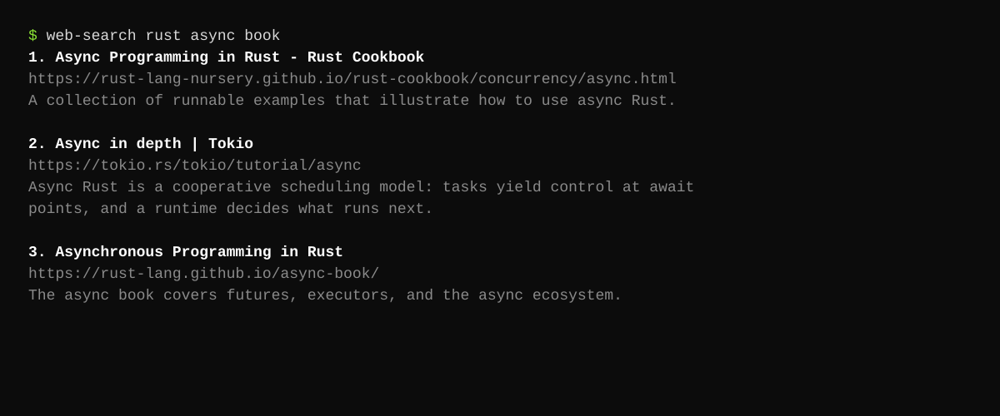

# web-search



## What it is

A terminal client that searches the web and prints ranked results as title, URL,
and snippet. It can also read a result as plain text without opening a browser.

## Why this exists

Searching from a terminal usually means either a full-screen browser or piping
`curl` output through grep. Both lose the shape of the results. This keeps the
search in the shell: one command, ranked output, and flags for scripts.

## How it works

1. The query comes from the arguments or from piped stdin.
2. Each engine is fetched over TLS with `ureq` and `rustls`, a request timeout,
   and an 8 MiB response cap.
3. DuckDuckGo HTML, Bing RSS, SearXNG JSON, and the Brave API are normalized into
   the same result shape.
4. Titles and snippets are cleaned and wrapped to `COLUMNS` (80 when unset).
5. `--read` fetches the selected page once and extracts article text with
   `dom_smoothie`. If extraction is too small, it can retry through `r.jina.ai`
   unless `--no-reader` is set.

## Usage

### Commands

| Command | Action |
| --- | --- |
| `web-search <query...>` | Search and print ranked results. |
| `web-search -r <n\|url>` | Read result `n`, or a URL, as plain text. |
| `web-search --urls <query...>` | Print only result URLs. |
| `web-search --json <query...>` | Print JSON. |

### Examples

```bash
web-search rust async book
web-search -n 5 --urls "rust 2024 edition"
web-search --json "who invented unix" | jq -r '.[].url'
echo "tauri vs egui" | web-search -n 5
web-search -e brave -n 20 "embedded rust"
web-search -r 2 rust async book
web-search -r https://example.com/
```

### Options

| Option | Meaning |
| --- | --- |
| `-n, --limit <n>` | Number of results, 1–50 (default: 10). |
| `-e, --engine <name>` | `auto`, `bing`, `ddg`, `searx`, or `brave`. |
| `-r, --read <n\|url>` | Read a result number or URL as plain text. |
| `--no-reader` | Do not retry client-side pages through `r.jina.ai`. |
| `--searx-url <url>` | SearXNG base URL. |
| `--json` | Print a JSON array. |
| `--urls` | Print only result URLs. |
| `-t, --timeout <secs>` | Per-request timeout (default: 15). |
| `-v, --verbose` | Print engine and timing to stderr. |

Exit codes: `0` for a completed search or read, `1` for a failed request, `2`
for usage errors.

### Reading a result

```bash
web-search -r 2 rust async book
web-search -r 2                    # result 2 of the previous search
web-search -r https://example.com/
```

The last result list is cached at `$XDG_CACHE_HOME/web-search/last.json`.
Reading keeps only that list; queries are not logged.

### Engines

| Engine | Source |
| --- | --- |
| `ddg` | DuckDuckGo HTML. |
| `bing` | Bing RSS. |
| `searx` | SearXNG JSON; set `--searx-url` or `SEARX_URL`. |
| `brave` | Brave API; set `BRAVE_API_KEY`. |

`auto` tries DuckDuckGo, Bing, then SearXNG.

### Limits

The HTML endpoints are not APIs. They can return bot checks or rate limits; use
the Brave API or a SearXNG instance for regular use. JavaScript-only pages still
read poorly, and PDFs are reported as unreadable.

## Install

**Requirements:** Rust 1.88+ and `git`.

```bash
cargo install --git https://github.com/batusaribay/web-search.git --locked
```

## Uninstall

```bash
cargo uninstall web-search
```

## Security

- TLS is handled by `rustls`.
- Only the selected engine and result URL are contacted.
- `--no-reader` disables the optional `r.jina.ai` fallback.
- Response sizes are capped and request timeouts are bounded.
- No credentials, cookies, configuration, or telemetry are read or sent.
- Unsafe code is forbidden by the package lint configuration.

## License

This project is licensed under the [MIT License](LICENSE).
